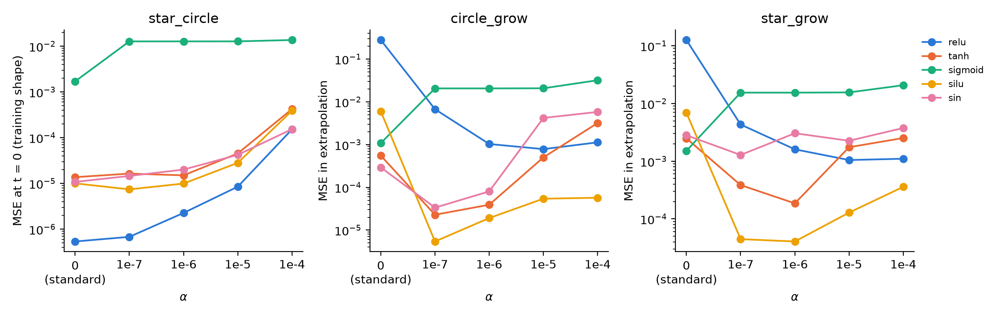
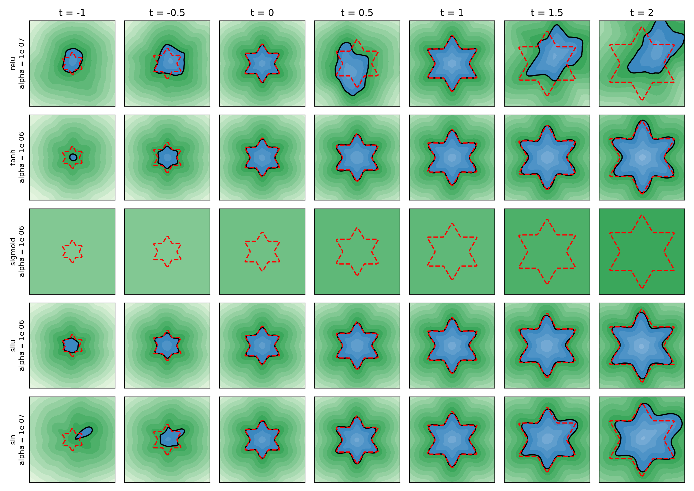

# Lipschitz MLP: how the activation shapes extrapolation

Experiments of our project for the MVA course *Geometric Data Analysis* on

> H.-T. D. Liu, F. Williams, A. Jacobson, S. Fidler, O. Litany.
> **Learning Smooth Neural Functions via Lipschitz Regularization.** SIGGRAPH 2022.
> [arXiv:2202.08345](https://arxiv.org/abs/2202.08345)

The code is built on the official JAX demo of the paper,
[`jaxgptoolbox/demos/lipschitz_mlp`](https://github.com/ml-for-gp/jaxgptoolbox/tree/main/demos/lipschitz_mlp).

## The paper in short

A neural field $f(x, t)$ maps a point $x$ and a latent code $t$ to a value, here the signed distance (SDF) of a 2D shape.
We want $f$ to change smoothly with $t$, so that it interpolates, and ideally extrapolates, well between the training shapes.

For an MLP with 1-Lipschitz activations, the Lipschitz constant of $f$ is bounded by the product of the layer norms, $\mathrm{Lip}(f) \le \prod_i \|W_i\|_\infty$.
The *Lipschitz MLP* learns one bound $\mathrm{softplus}(c_i)$ per layer, rescales the rows of $W_i$ so that $\|W_i\|_\infty \le \mathrm{softplus}(c_i)$, and adds the product of the bounds to the loss:

$$\mathcal{L} = \mathrm{MSE}(t=0) + \mathrm{MSE}(t=1) + \alpha \prod_i \mathrm{softplus}(c_i).$$

## Our experiment

The bound assumes 1-Lipschitz activations, and the official 2D demo only uses ReLU.
**How does the activation change the interpolation and the extrapolation of a Lipschitz MLP?**

- **Activations:** ReLU, tanh, sigmoid, SiLU, sine.
- **Regularisation weight:** $\alpha \in \{0, 10^{-7}, 10^{-6}, 10^{-5}, 10^{-4}\}$ ($\alpha = 0$: standard MLP, without the normalisation).
- **Toys:** each network is trained only at $t = 0$ and $t = 1$, and evaluated for $t \in [-1, 2]$.
  - `star_circle`: the toy of the paper, a star at $t = 0$ and a circle at $t = 1$ (no ground truth for other $t$);
  - `circle_grow`: a circle of radius $0.2 + 0.1t$;
  - `star_grow`: a star of size $0.12 + 0.05t$.
- **Metric:** MSE to the true SDF on a $128 \times 128$ grid, averaged over $t \in [0, 1]$ (interpolation) and over $t \in [-1, 0) \cup (1, 2]$ (extrapolation).
- **Choice of $\alpha$:** for each activation, the largest $\alpha > 0$ whose training error stays below twice that of the standard MLP. If there is none, we take the $\alpha$ with the smallest training error (marked †).

The network, the optimiser and the training are those of the official demo:
5 hidden layers of 64 neurons, Adam with step size $10^{-4}$, 200,000 iterations, 512 random points per iteration.

## Main results

MSE in extrapolation, for the standard MLP ($\alpha = 0$) and at the selected $\alpha$:

| Activation | Circle: $\alpha$ | Circle: $\alpha=0$ | Circle: selected | Star: $\alpha$ | Star: $\alpha=0$ | Star: selected |
|---|---|---|---|---|---|---|
| ReLU    | 1e-5  | 2.8e-1 | 7.8e-4 | 1e-7  | 1.3e-1 | 4.3e-3 |
| tanh    | 1e-7† | 5.5e-4 | 2.3e-5 | 1e-6  | 2.5e-3 | 1.9e-4 |
| sigmoid | 1e-7† | 1.1e-3 | 2.1e-2 | 1e-6† | 1.5e-3 | 1.5e-2 |
| SiLU    | 1e-7  | 6.0e-3 | **5.4e-6** | 1e-6 | 6.9e-3 | **4.1e-5** |
| sine    | 1e-7† | 2.9e-4 | 3.4e-5 | 1e-7  | 2.8e-3 | 1.3e-3 |

- A small $\alpha$ improves extrapolation for every activation except sigmoid, by a factor of 2 (sine, star) to 1000 (SiLU, circle).
- On both toys, SiLU extrapolates best and ReLU worst (apart from sigmoid).
- **Sigmoid fails for any $\alpha > 0$.** Its Lipschitz constant is $1/4$, so the true bound is $(1/4)^5 \prod_i \|W_i\|_\infty$, 1024 times smaller than the quantity the regulariser penalises.
  After training, this true bound is below 1, while an SDF has slope 1: the network outputs an almost constant function.



*Effect of $\alpha$. Left: training error on the toy of the paper. Middle and right: MSE in extrapolation on the two toys with a ground truth.*



*Growing star, each activation at its selected $\alpha$. Black: learned shape; red dashed: ground truth. Columns $t = 0$ and $t = 1$ are the training shapes.*

## Run

The code imports `jaxgptoolbox`, so clone this repository inside the `demos` folder of the toolbox:

```bash
git clone https://github.com/ml-for-gp/jaxgptoolbox.git
cd jaxgptoolbox/demos
git clone https://github.com/eliasmassaro-hub/Research-Project-Lipschitz-MLP.git
cd Research-Project-Lipschitz-MLP
pip install "jax[cpu]" libigl scipy matplotlib tqdm
```

The trained weights are in `results/`, so the metrics and the figures take about a minute:

```bash
python evaluate.py   # results/metrics.csv, results/best_alpha.csv
python figures.py    # results/figures/
```

To retrain everything, delete the `.pkl` files and run `bash run_all.sh` (about 7 hours on a laptop CPU).
The seed is fixed: on the same machine and library versions, retraining gives bit-identical weights (we checked it for the 75 networks).

## Files

| File | Content |
|---|---|
| `model.py` | Lipschitz MLP of the official demo, with the activation, the initialisation and the normalisation as parameters |
| `toys.py` | Activations, values of $\alpha$, toys (true SDF) and loading of a trained network |
| `main_lipmlp.py` | Training of the 75 networks (3 toys × 5 activations × 5 values of $\alpha$); trained runs are skipped |
| `evaluate.py` | MSE of every network and choice of $\alpha$ |
| `figures.py` | Figures |
| `run_all.sh` | Training, metrics and figures |

Changes to the official `model.py`: the activation is a parameter instead of ReLU;
Glorot initialisation for tanh, sigmoid and sine (He, as in the original, for ReLU and SiLU);
a `lipschitz` flag to turn the normalisation off ($\alpha = 0$);
`jax.example_libraries` instead of `jax.experimental` for the optimiser.
`model.py` and `main_lipmlp.py` are adapted from [jaxgptoolbox](https://github.com/ml-for-gp/jaxgptoolbox) (Apache License 2.0).
